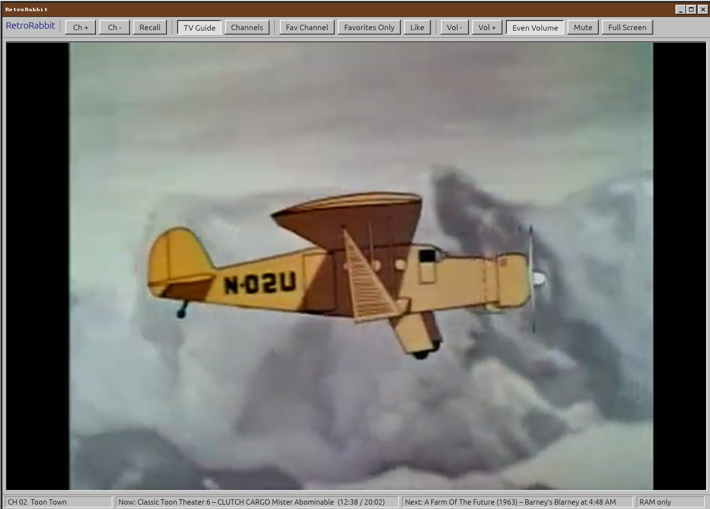
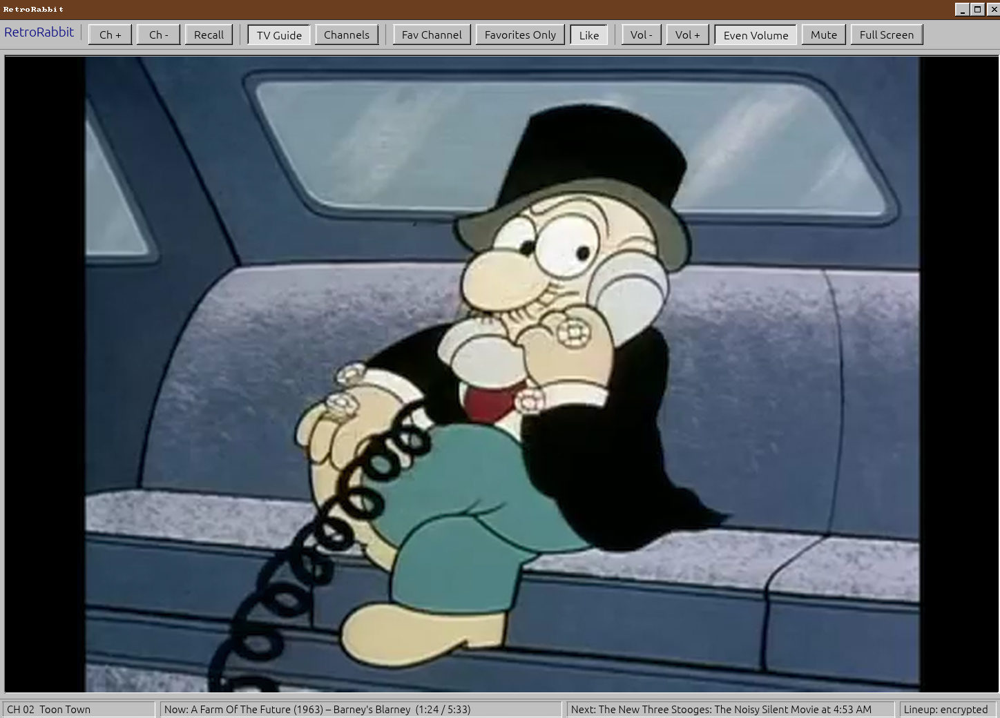
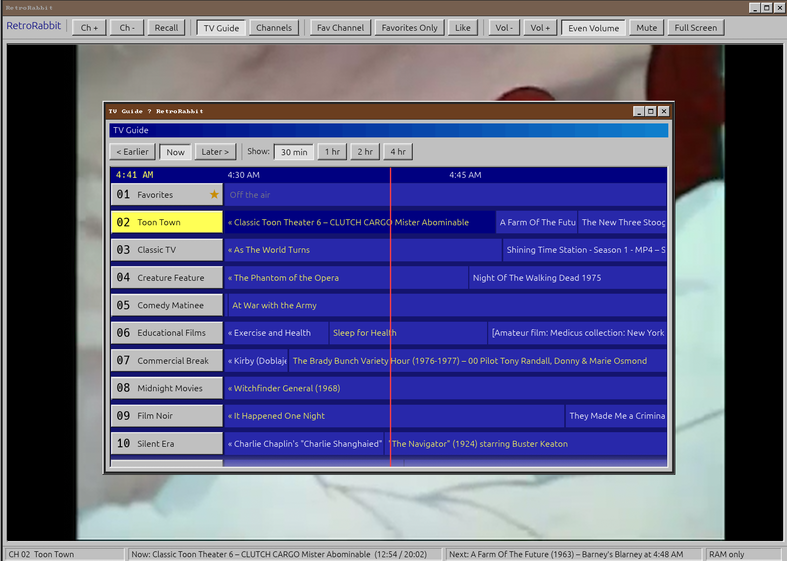
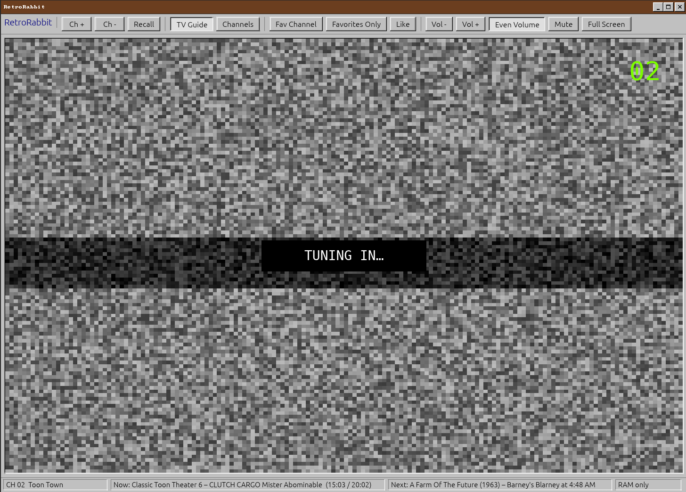

# RetroRabbit

**Your own little cable TV.** RetroRabbit turns old public-domain films, cartoons,
TV shows and your own videos into channels that are always on the air. You don't
pick something to watch, you flip channels, and whatever is on is already halfway
through, just like real TV.

It ships with 26 ready-to-watch channels streamed from the
[Internet Archive](https://archive.org), so it's fun even with no media of your own.
Everything has a Windows 95 look.



## Features

- **Always on the air.** Every channel has been "broadcasting" since 2000-01-01.
  What's on right now is worked out from the clock, so you join shows partway
  through, and flipping away and back finds the show further along.
  Nothing is stored, so the schedule is the same after a restart.
- **26 Internet Archive channels.** Cartoons (classic, Saturday morning, 80s, 90s,
  web-era, claymation), classic TV from the 50s and 60s, film noir, silent films,
  westerns, mysteries, B-movie midnight movies, game shows, trailers, vintage
  commercials, educational films, *Computer Chronicles* and more. Streamed, never
  downloaded.
- **Your own media.** Point it at your folders and it builds channels per folder
  and per genre. Tags come from the files themselves (ffprobe metadata like genre
  and date), folder names, and episode names like `Show.S02E05.mkv`.
- **Channels are rules, not playlists.** A channel airs anything matching a
  folder, a tag (`genre = horror`, `decade = 1980s`), a show, an Internet Archive
  search, or what you've liked. Shuffle, or in order for episodes.
- **TV guide.** A scrolling program grid with zoom (30 min to 4 hours), paging
  through time, and click-to-tune.
- **Favorites.** Star channels and surf favorites only, or press Like on anything
  that's airing and it shows up on channel 01, Favorites.
- **Like a real set.** Static and hiss between channels, green channel numbers,
  color bars when there's no signal, number keys to type a channel, and a recall
  button.
- **Even Volume.** Levels loudness between programs like a TV station does, so a
  loud ad and a quiet 1930s film sound about the same.





## Privacy: RAM only

RetroRabbit keeps everything in memory:

- The library index, Internet Archive results and mpv's cache stay in RAM.
- mpv runs with no user config, no scripts, no resume files and no disk cache.
- The only thing ever written to disk is your channel lineup, and only when you
  press **Save** in the channel editor. It's encrypted with your passphrase
  (Argon2id + XChaCha20-Poly1305).



## Install

You need:

- Rust (stable)
- `mpv` and `ffprobe` (from ffmpeg)
- An X11 session (or XWayland)

On Debian or Ubuntu:

```sh
sudo apt install mpv ffmpeg
```

Then:

```sh
git clone https://github.com/anti-ghostsec/retrorabbit
cd retrorabbit
cargo run --release -- ~/Videos
```

## Usage

```
retrorabbit [OPTIONS] [FOLDER...]

  FOLDER          Media folders to scan (default: ~/Videos)
  --channel N     Start on channel N
  --guide         Open the TV guide
  --channels      Open the channel editor
  -h, --help      Show help
```

| Key / mouse | Does |
| --- | --- |
| Up / Down, PgUp / PgDn | Change channel |
| 0–9 | Type a channel number |
| Backspace | Back to the last channel |
| G / C | TV guide / channel editor |
| S / L / O | Favorite channel / like what's on / favorites only |
| I | What's on |
| M, + / − | Mute, volume |
| Mouse wheel, middle click | Volume, mute |
| N | Even Volume on/off |
| F, double-click | Full screen |

## How it works

- **Schedule.** A channel's playlist is built from its rules and played end to
  end, starting over (reshuffled) when it runs out. "Now" is just
  `(time since the epoch) mod (playlist length)`, so no schedule is ever saved.
- **Internet Archive.** Each channel takes the 40 most-downloaded videos in its
  search, plus 80 picked at random from the next 1,000. The random pick is seeded
  by the search, so it's the same on every run. Every channel loads a starter set
  first, so the whole guide fills in quickly, then the rest arrives in the
  background.
- **Video.** The system `mpv` draws into a window embedded in RetroRabbit's own,
  controlled over its IPC socket.
- **UI.** [egui](https://github.com/emilk/egui), styled as Windows 95.

## License

[MIT](LICENSE). The videos come from the Internet Archive and belong to their
respective owners. RetroRabbit only streams them.
